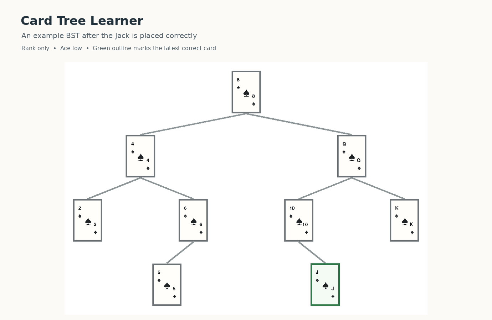
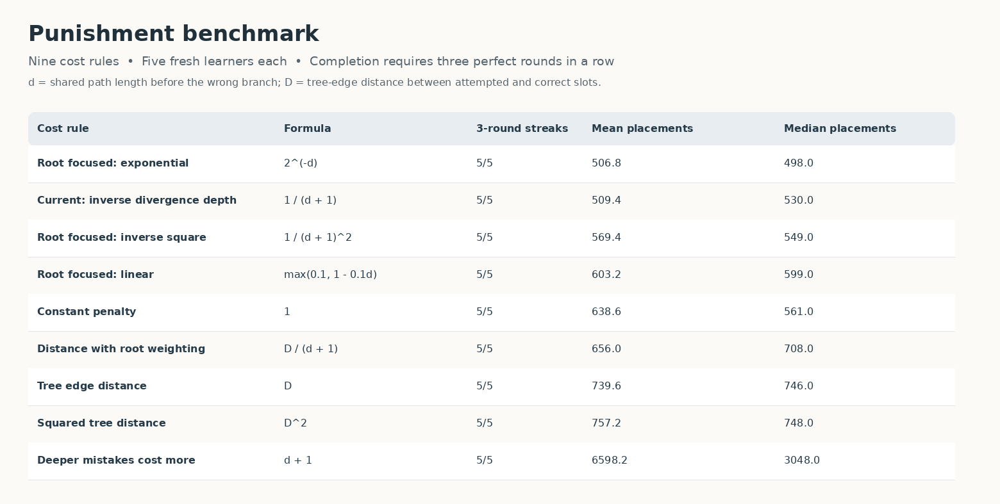

# cardtree_ml

The curiosity began with a **kortstokk** (a deck of cards) in the mountains of
Nepal. While using it to teach a friend about binary search trees, we wondered:
could a machine learn to place cards correctly from feedback?

This project explores that question with a small reinforcement-learning agent
and a visual Python desktop app.

## The card tree

The agent builds a binary search tree using card ranks. Ace is low, and suits
are only visual decoration. A green outline marks a card the agent placed
correctly.



Each round starts with 4–10 cards in a fresh tree. The agent tries each
remaining card once. Correct cards stay in the tree; incorrect cards get a
penalty and are discarded.

Training is complete after **three perfect rounds in a row**. Any mistake
resets the streak. The agent’s learned policy and progress are saved locally
in `~/.cardtree_ml/policy.json`.

## Compare punishment rules

The **Benchmark punishments** button compares nine cost functions. It trains
five fresh agents per function and reports how often they achieve a three-round
streak, plus the mean and median placement iterations.



The benchmark shows an initial experiment, not a general result. See
[`docs/cardtree-learning.md`](docs/cardtree-learning.md) for the learning update,
cost formulas, and findings.

## Run the app

Use Python 3.10 or later with Tkinter available:

```sh
python3 -m cardtree_ml
```

The visible app pauses for about two seconds between placements. **Train until
3 perfect rounds** runs rounds without animation, then opens a fresh visual
round when training completes.
